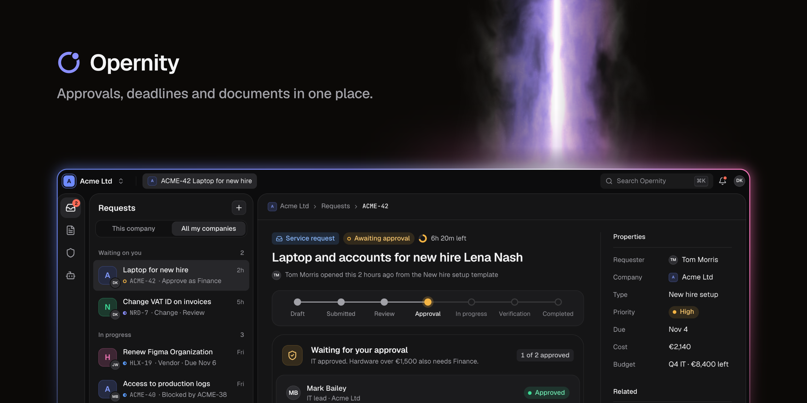

# Opernity

**Approvals, deadlines and documents in one place.** Operations and governance for companies and company groups.

Opernity brings the work that usually lives in inboxes, spreadsheets and shared folders into one place, for every
company you run:

- **Requests and approvals:** numbered requests per company, staged approvals and SLAs that pause while waiting.
- **Workflows and routines:** set up who approves and what escalates on a visual builder, no code needed.
- **Documents and contracts:** versions, review, the signed copy and a reminder before the notice deadline.
- **Assets and vendors:** who has every laptop, license and seat; one record per supplier with its contracts and spend.
- **Compliance and risk:** controls, evidence and incidents, and which controls lack evidence before an auditor asks.
- **Knowledge base:** every page has an owner and a review date.
- **AI agents and MCP:** agents draft, review and triage, and the AI assistant you already use can connect over MCP.
  Both work with the person's own access. People still approve, sign and grant access.

Each company keeps its own data, members and invoice, and the companies you administer can be linked to work
together. Opernity runs as a cloud service, or as **Dedicated**: your own installation where you choose, operated by
our team.

## Early access

Early access opens company by company: [opernity.eu](https://opernity.eu)

- Sales: [sales@opernity.eu](mailto:sales@opernity.eu)
- Security: [security@opernity.eu](mailto:security@opernity.eu)

Opernity is made by Roundly Consulting s.r.o. Screens show sample data.
